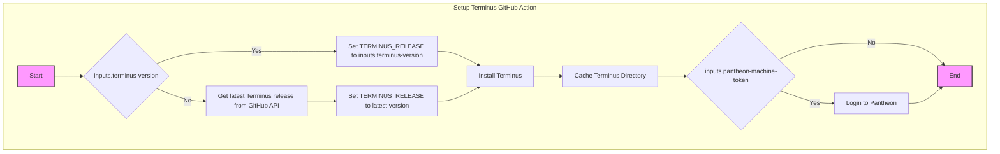

[](https://pantheon.io/docs/oss-support-levels#actively-maintained-support)

# Terminus GitHub Actions

A GitHub Action for quickly installing and configuring the Pantheon CLI tool,
[Terminus](https://github.com/pantheon-systems/terminus).

## Usage

In order to avoid deprecation warnings, it's recommended to use the
[`setup-php`](https://github.com/shivammathur/setup-php) action rather than rely
on the version of PHP that is installed by default on GH runners.

```yaml
steps:
  - name: Setup PHP
    uses: shivammathur/setup-php@v2
    with:
      php-version: "7.4"

  - name: Install Terminus
    uses: pantheon-systems/terminus-github-actions@v1
    with:
      pantheon-machine-token: ${{ secrets.PANTHEON_MACHINE_TOKEN }}

  - name: List sites
    run: terminus site:list
```

By default, this action installs the latest version of Terminus that has been
released on GitHub. You can provide a specific version of Terminus to install
using the `terminus-version` input:

```yaml
steps:
  - name: Setup PHP
    uses: shivammathur/setup-php@v2
    with:
      php-version: "7.4"

  - name: Install Terminus
    uses: pantheon-systems/terminus-github-actions@v1
    with:
      pantheon-machine-token: ${{ secrets.PANTHEON_MACHINE_TOKEN }}
      terminus-version: 2.6.5

  - name: List sites
    run: terminus site:list
```

This action will encrypt and cache the Terminus session by default to be re-used across jobs in a workflow to reduce the number of authorizations. If you need to disable this for some reason, you can set the `disable-cache` option to `true`.

```yaml
steps:
  - name: Install Terminus
    uses: pantheon-systems/terminus-github-actions@v1
    with:
      pantheon-machine-token: ${{ secrets.PANTHEON_MACHINE_TOKEN }}
      disable-cache: true
```

Please note that in order to run commands that require SSH (e.g. drush or wp-cli), you will need to setup a SSH key. There are plenty of options available in the [Github Actions Marketplace](https://github.com/marketplace?type=actions&query=ssh+key+). We recommend you to choose one of them and use them in your pipeline.

## Diagram



## Rollback

- **When:** a release breaks consumers' workflows (a failed "Install Terminus" or "Authenticate Terminus" step) after a merge to `main`.
- **Recover:** revert the change on `main` through a PR. The merge cuts the next patch release in seconds. Never delete or move a published tag. Consumers pinned to a bad SHA re-pin to the previous release; if the `v1` branch was advanced to a bad commit, reset it to the recorded SHA.
- **Verify:** the latest release and `git ls-remote origin refs/heads/v1` match what you recorded before the merge, and a consumer workflow run is green.
- **Who to page:** `#ask-hosting` (owner: developer-experience). Nobody is paged automatically.

Full procedure, including what consumers pin: [DEPLOYMENT.md](DEPLOYMENT.md#rollback).

## Credits

Big thanks to <a href="https://github.com/G-Rath">Gareth Jones</a> and <a href="https://www.ackama.com/">Ackama</a> for the initial development work.
